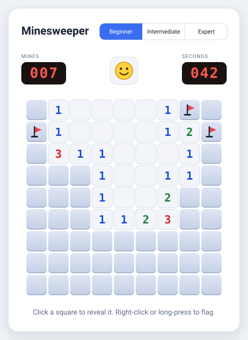

<div align="center">

# Minesweeper

**A fast, clean Minesweeper for the browser. Play it online, install it as an app, or fork it.**

[](../../actions)
[](LICENSE)




</div>

---

## Features

- **Three levels:** Beginner (9×9, 10 mines), Intermediate (16×16, 40) and Expert (30×16, 99)
- **Fair starts:** the first click is always safe and opens up some space
- **Full classic toolkit:** mine counter, timer, face button, flagging and chording
- **Best times** saved per level in your browser
- **Works everywhere:** mouse, touch (long-press to flag, or use Flag mode) and keyboard
- **Responsive:** on phones the Expert board rotates to 16×30 so squares stay tappable
- **Light and dark themes** that follow your system setting
- **Installable and offline-ready** as a Progressive Web App
- **Zero dependencies, no build step:** just HTML, CSS and JavaScript

## Controls

| Action   | Mouse                             | Touch                              | Keyboard                    |
| -------- | --------------------------------- | ---------------------------------- | --------------------------- |
| Reveal   | Left click                        | Tap                                | `Space` / `Enter`           |
| Flag     | Right click                       | Long-press, or turn on **Flag mode** | `F`                       |
| Chord    | Click a number (or middle click)  | Tap a number                       | `Space` / `Enter` on a number |
| Move     |                                   |                                    | Arrow keys                  |
| New game | Face button                       | Face button                        | `R`                         |

> **Chording:** when the number of flags around a revealed number matches that number, clicking it opens all the remaining neighbours at once. A wrong flag means a mine gets opened, so flag carefully.

## Getting started

Open `index.html` in any modern browser and play.

To try the install and offline features, serve the folder over HTTP instead:

```bash
python3 -m http.server 8000
# then visit http://localhost:8000
```

## Deploy to GitHub Pages

1. Create a repository on GitHub and push this project:

   ```bash
   git init
   git add .
   git commit -m "Add Minesweeper"
   git branch -M main
   git remote add origin https://github.com/<your-username>/<your-repo>.git
   git push -u origin main
   ```

2. Open **Settings → Pages**, set **Source** to **Deploy from a branch**, choose **main** and **/ (root)**, and save.
3. After about a minute the game is live at `https://<your-username>.github.io/<your-repo>/`.

Tip: paste that address into the repository's **About → Website** field so visitors can find the game from the repo page.

## Install as an app

Open the live site, then:

| Platform                 | How                                                    |
| ------------------------ | ------------------------------------------------------ |
| Chrome / Edge (desktop)  | Install icon in the address bar, or menu → **Install** |
| Android (Chrome)         | Menu → **Install app** / **Add to Home screen**        |
| iPhone / iPad (Safari)   | Share → **Add to Home Screen**                         |

## How it works

The code is split so the rules can be tested without a browser.

- **`engine.js`** holds all the game rules and never touches the page: mine placement, flood-fill reveal, flags, chording, win and lose. Mines are only placed on the first click, which is what guarantees a safe start.
- **`app.js`** draws the board, handles mouse, touch and keyboard input, runs the timer and stores best times.
- **`sw.js`** is a small service worker that caches the app so it works offline.

## Project structure

```text
.
├── index.html              Page structure
├── style.css               Layout, themes, cell styling
├── engine.js               Game rules (no DOM)
├── app.js                  UI, input, timer, best times
├── manifest.webmanifest    App install metadata
├── sw.js                   Offline caching
├── icon.svg, icon-*.png    App icons
├── docs/preview.svg        README image
├── test/engine.test.js     Engine tests
└── .github/workflows/      CI
```

## Development

There is nothing to install. Run the tests with Node 18 or newer:

```bash
npm test        # or: node --test
```

CI runs the same tests on every push and pull request.

When you change files that ship with the app, bump `CACHE` in `sw.js` (for example `minesweeper-v2`) so installed copies pick up the update.

## Ideas for next steps

- Custom board sizes and mine counts
- Sound effects and a mute toggle
- A hint button that reveals a guaranteed-safe square
- Question-mark marks, and a stats screen with win rate

Contributions are welcome: see [CONTRIBUTING.md](CONTRIBUTING.md).

## License

[MIT](LICENSE)
